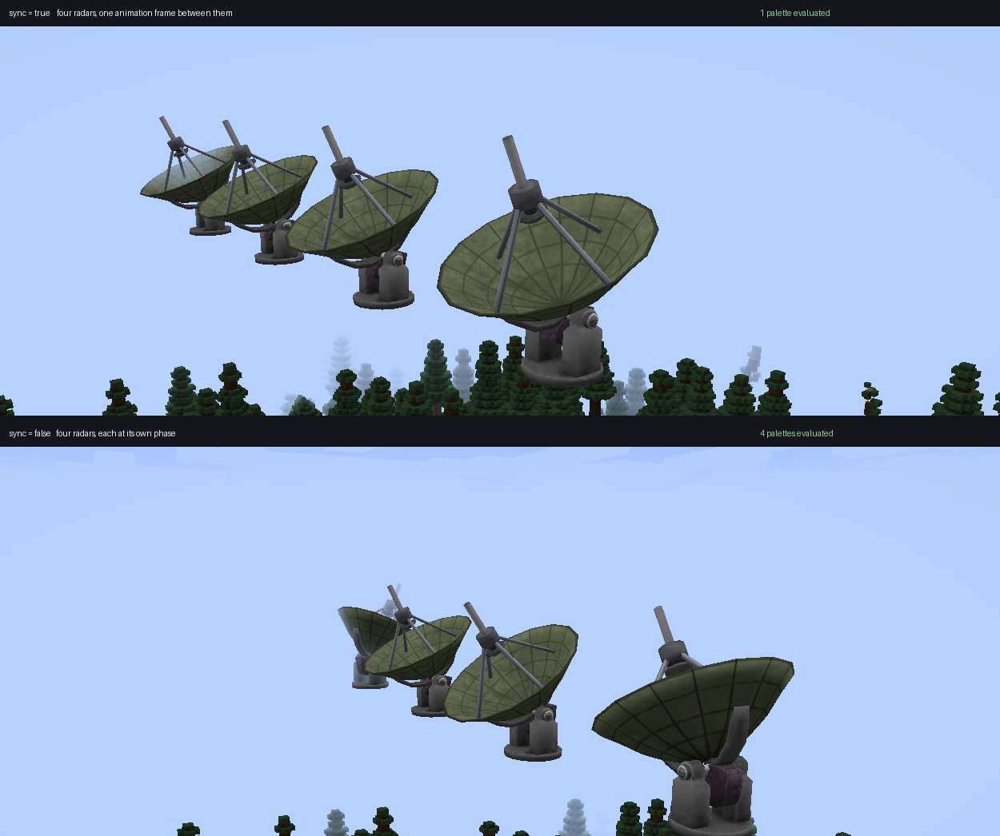

# GemRender

GPU-driven model and animation renderer for Minecraft. glTF 2.0 import, Flywheel instancing and GPU culling,
skinning in the vertex shader: animated models stay instanced, one draw per model per batch. Client side only.



## Features

- **glTF 2.0**: node animation, skins, morph targets; metallic-roughness with normal, emissive and occlusion maps.
  Textures stitched at import => multi-part model = one draw. Bedrock `.geo.json` through the same pipeline.
- **Rigging in code**: `RigBuilder` skeleton + Wavefront OBJ parts, for models that ship without one.
- **Block entities, entities, vehicles**: entity path handles models still importing and culls on the model's own bound.
- **Items, armour, first-person hand**: same retained path, outside the level.
- **Animation**: phase = f(world clock, position), no stored state; copies at the same instant share one bone palette.
  Crossfades, masks and additive layers (`AnimationBlend`). Drivers (e.g. `NodeSpin`) compose with clips.
- **Variants and paint**: liveries/camo/team colours stitched into one sheet, picked per instance; shared paint
  layer. Differently skinned copies still draw in one batch.
- **Particles**: closed form of age; 64 B written once at spawn, nothing per frame. Decals, rigid glTF particles,
  contact response.
- **Ropes, cables, chains**: closed form of the two endpoints; one instance each, all ropes one draw.
- **Point and spot lights**: forward shaded on terrain, entities, Flywheel instances, hand; cookies; voxel shadows.
- **Transparency**: order-independent, ordered against water and clouds.
- Distance-scaled animation rate, KTX2 textures, BC7-compressed atlases, bone attachment queries.

```java
NodeTable nodes = model.layout().nodeTable();
GltfAnimation turning = model.animation("running_loop")
        .with(NodeSpin.aboutY(nodes, nodes.slotOf(mastNode), rpm / 60.0f));
```

## Using it

API guide: **[docs/INTEGRATION.md](docs/INTEGRATION.md)**.

```gradle
dependencies {
    compileOnly files('libs/gemrender-<version>.jar') // versions/<target>/build/libs
}
```

Required client dependency of a mod drawing through it: declare it in `neoforge.mods.toml` / `mods.toml` /
`fabric.mod.json`. Same public API on every target except two 26.1 seams:

- Item renderer claimed in **model JSON** (`"type": "minecraft:special"` naming `gemrender:model`), not
  `IClientItemExtensions`. `GemRenderItemRenderer.register(id, renderer)` unchanged.
- `ArmorAppearance` receives a `null` `LivingEntity` (armour chosen from render state); stack still present.

## Targets

| | 1.21.1 NeoForge | 1.21.1 Fabric | 1.20.1 Forge | 1.20.1 Fabric | 26.1.2 NeoForge | 26.1.2 Fabric | 26.2 NeoForge |
|---|---|---|---|---|---|---|---|
| Loader | NeoForge 21.1.248 | Loader 0.19.3, API 0.116.15 | Forge 47.4.23 | Loader 0.19.3, API 0.92.2 | NeoForge 26.1.2.109 | Loader 0.19.5, API 0.155.3 | NeoForge 26.2.0.93 |
| Java | 21 | 21 | 17 | 17 | 25 | 25 | 25 |
| Flywheel | 1.0.6, bundled | 1.0.6, bundled | 1.0.6, bundled | 1.0.6-281, bundled | 1.0.7 fork, **provided** | 1.0.7 fork, **provided** | CrankShaft 1.6.1, **install separately** |
| Iris shader packs | yes | yes | no | yes (Colorwheel) | no | no | no |
| Lights | yes | yes | yes | yes | yes | yes | yes |
| Terrain transparency | GemRender split | GemRender split | GemRender split | GemRender split | opt-in split | opt-in split | CrankShaft chunk OIT |

- Bundled Flywheel: Create nests the same coordinate => one copy; a Flywheel in `mods/` displaces it.
- 26.1: Flywheel vendored + ported (`src/flywheel`, MIT; Fabric platform layer in `src/flywheelFabric`); a Flywheel
  in `mods/` = duplicate mod id, load failure.
- 26.1 water split: on => OIT composited on the wrong side of water. `-Dgemrender.watersplit=force` /
  `-Dgemrender.cloudsplit=force` to enable.
- 26.2: CrankShaft's `TRANSLUCENT_OIT` terrain mode orders translucent models, particles, ropes and volumes
  with terrain. `absorbance` factories use ordinary OIT; cooling glows use absorbing and ordered additive
  materials in that same scene. GemRender's water split, reduced absorbance passes and camera-fog replacement
  are inactive on this target. Older targets retain their existing rendering paths.
- 26.2 requires CrankShaft's OpenGL backend; GemRender's Vulkan support is not implemented.
- OpenGL: Flywheel's 3.3 floor; 4.2 for BC7 only.
- Iris optional; its package is entered only after a `ModList` check.
- `org.lwjgl:lwjgl-ktx` jar-in-jar'd (struct classes + natives), called through LWJGL's libffi: works on 1.20.1's LWJGL 3.3.1.

## Building

```bash
./gradlew buildAll                      # every buildable target: compile, unit tests, GLSL validation
./gradlew testAll                       # unit tests, no GPU
./gradlew :1.21.1:glTest                # GPU tests, GL 4.6 driver; skips without one
./gradlew client                        # dev client, active target (`:1.21.1:runClient` explicit)
./gradlew "Set active project to 1.20.1"
```

Root `runClient` launches every target; use `client` or the `:<target>:` form.

Releasing: push a tag matching `mod_version` (`git tag -a v0.1.18 -m "notes"`, `-beta.1` / `-alpha.1` for those types).
`.github/workflows/release.yml` builds every target and uploads to Modrinth and CurseForge (`gradle/publish.gradle`,
secrets `MODRINTH_TOKEN`, `CURSEFORGE_TOKEN`). Locally: `./gradlew publishAllMods -Ppublish.dryRun=true`.

## Layout

| | |
|---|---|
| `src/main` | the mod, shared by all targets (Stonecutter) |
| `src/test`, `src/ktxTest` | unit tests; GPU tests tagged `gl` |
| `src/flywheel` | vendored Flywheel, 26.1 only |
| `src/flywheelFabric` | its Fabric platform layer, 26.1 Fabric only |
| `src/harness`, `src/bench` | dev spike, cross-framework benchmark |
| `versions/<target>` | per-target properties and build output |

## Licence

GemRender is licensed under LGPL-3.0-only. See [LICENSE](LICENSE) for the GPLv3 terms
and [LICENSE.LESSER](LICENSE.LESSER) for the LGPLv3 additional permissions.
Vendored third-party source keeps its own licence.
